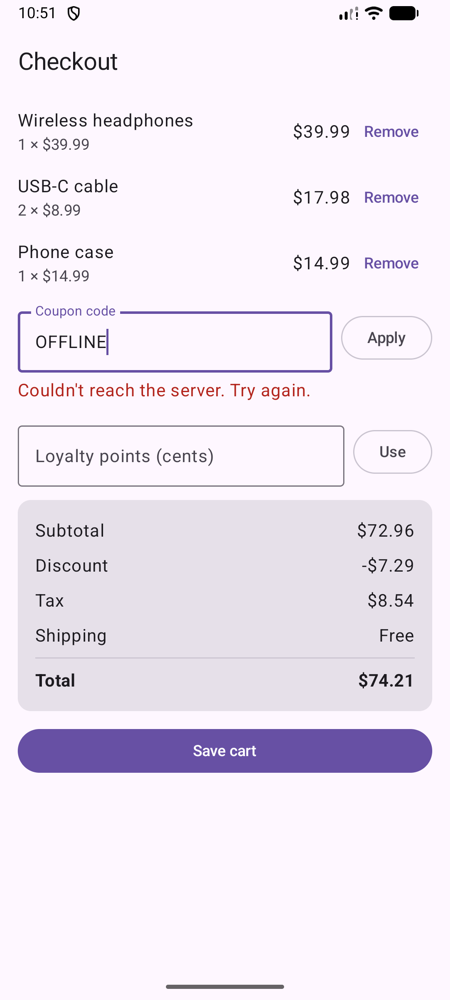

# Tests that can't fail

Do the unit tests an AI agent writes actually catch bugs? This repo answers it the only direct way:
break the code on purpose, one business rule at a time, and see whether any test goes red.

A small Android checkout (Kotlin, Compose, a hand-rolled MVI store) has 9 business rules and a
catalog of 15 realistic mutations, one per rule edge. Fresh Claude Code agents wrote the test suites
in isolated copies of the repo, without ever seeing the mutations. Every suite was then measured
with the catalog, with [PIT](https://pitest.org) and with Kover line coverage.



## Results

| Suite | Tests | Mutations caught | PIT `:core` | Kover lines |
|---|---|---|---|---|
| Opus — "write unit tests" | 88 | **15/15** | 77% | 96.9% |
| Haiku — "write unit tests" | 92 | 14/15 | 79% | 96.9% |
| Sonnet — "write unit tests" | 61 | 13/15 | 76% | 88.9% |
| Sonnet — then "prove each test by breaking the code" | 69 | 14/15 | 77% | 88.9% |
| Opus — ticket + tests | 20 | 6/15 (6/6 in the ticket's scope) | 46% | 74.0% |
| Opus — ticket, then "prove each test" | 88 | **15/15** | 76% | 96.9% |

What the numbers say:

- **Line coverage didn't tell the suites apart.** Haiku and Opus both cover 96.9% of lines; one lets a
  bug through, the other doesn't. Sonnet's coverage stayed at 88.9% while the number of caught bugs went up.
- **The bugs that got through were tests aimed at the wrong thing, not missing tests.** Two suites
  tested "a rejected code keeps the previous coupon" starting from a cart with *no* coupon applied, so
  dropping the coupon changed nothing they could see. One suite tested the discount row by passing the
  flag by hand; it rendered the screen that decides the flag in ten other tests, but never with a
  discount.
- **Asking the agent to break each rule itself works for rules written as code.** It found and fixed
  the Compose wiring gap. It did not find the rule enforced by *omission* (the reducer simply never
  touches the applied coupon): breaking it means adding code rather than changing a line, and the
  agent reported everything as caught. Other agents did catch it, so this is one run, not a law.

Full tables, the exact prompts and every agent's own report are in [`experiment/`](experiment/).

## Run it yourself

You need JDK 21 and the Android SDK (`local.properties` with `sdk.dir`).

```bash
git checkout v1-sonnet
./scripts/mutate.sh --all        # applies each mutation, runs the tests, restores the code
```

Each line of the output says whether a test caught that bug and which one. Other useful commands:

```bash
./scripts/mutate.sh M09          # a single mutation
./scripts/mutate.sh --check      # only check that every patch still applies
./gradlew koverXmlReport         # line coverage
./gradlew :core:pitest           # PIT mutation score
```

The feature arm wrote its own production code, so its catalog is ported:

```bash
git checkout v1-feature-measured   # the agent's code and tests, plus the ported catalog
MUTATIONS_DIR=mutations/feature-arm ./scripts/mutate.sh --all
```

The same `MUTATIONS_DIR` works on `v2-feature`.

## Tags

| Tag | Contents |
|---|---|
| `v0-no-tests` | Production code, mutation catalog, `mutate.sh`, protocol. No tests. |
| `v1-ai-suite` | Opus, "write unit tests" (also on `main`) |
| `v1-haiku`, `v1-sonnet` | The same prompt with other models |
| `feature-base` | `v0` with the coupon-failure handling removed, as a ticket would find it |
| `v1-feature` | Opus implementing that ticket "and add tests" |
| `v1-feature-measured` | `v1-feature` plus the catalog ported to the agent's code (what was measured) |
| `v2-sonnet`, `v2-feature` | A fresh agent asked to prove each test by breaking the rule it protects |

## How the experiment was run

- Each agent was a fresh, headless Claude Code session with no plugins, hooks or skills, working in a
  throwaway copy that had no mutation catalog, no measurement tooling and no git history.
- One run per suite, no re-rolls. Tests that failed on correct code would have been removed and
  listed; none did. No agent changed production code outside its ticket.
- The protocol was committed before each run, including the extra arms, which were added after the
  first result: [`experiment/protocol.md`](experiment/protocol.md). One follow-up run (v2 on Sonnet's
  suite) was decided after seeing the arm results and is marked as such.
- The author wrote an [oracle suite](experiment/oracle/) to prove each mutation is a real bug.
  It never ran in any measurement.

## Layout

```
core/        pure Kotlin: pricing rules, MVI store, repositories (JUnit 5, MockK, PIT, Kover)
app/         Android + Compose: ViewModel and checkout screen (Robolectric, compose-ui-test)
mutations/   the 15 mutations as patches, plus catalog.tsv
scripts/     mutate.sh
experiment/  protocol, prompts, agent reports, results, oracle
```

Article: ARTICLE_URL

MIT License.
